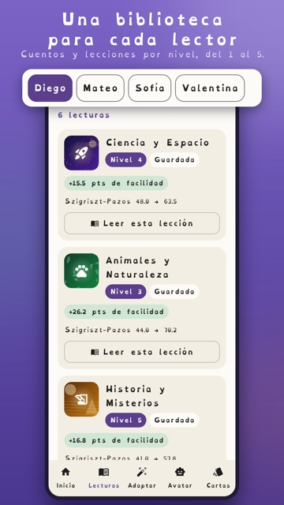
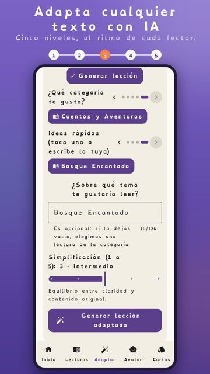
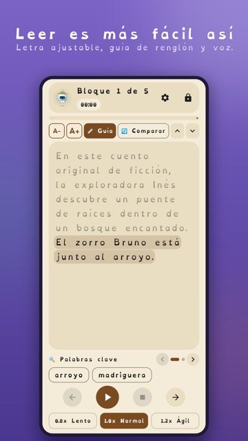
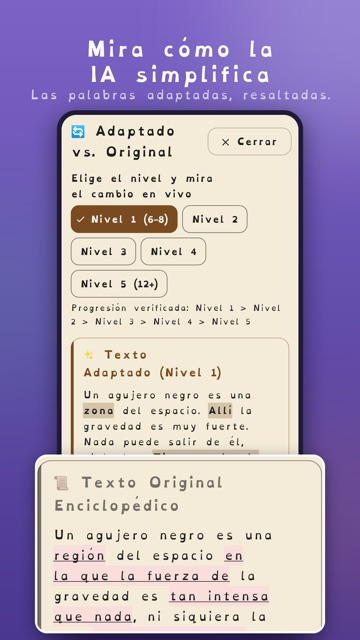

# Fluilet · App Android

**Fluilet** es una app de lectura asistida por inteligencia artificial que **adapta textos y PDF al nivel de lectura** de cada persona. Está pensada para niñas y niños que leen acompañados de un tutor, y para adultos que leen de forma independiente.

Esta es la app Android. El servidor y el modelo de IA están en [fluilet-backend](https://github.com/juandiego-acosta/fluilet-backend).

> Proyecto académico presentado en la Exposición Final de la materia Proyecto (CETI Colomos, noviembre de 2026). Desarrollo técnico (app, servidor e IA): Juan Diego Acosta Bohorquez. Documentación: mi compañera de equipo.

## Capturas

| Lecturas y niveles | Adaptador con IA | Lector accesible | Comparador |
|---|---|---|---|
|  |  |  |  |

## Qué hace

- **Adaptador con IA:** envía un texto o un PDF al servidor y recibe una versión más fácil de leer, según el nivel elegido.
- **Comparador:** muestra el texto original junto a la versión adaptada, con métricas de legibilidad.
- **Lector accesible:** tipografía OpenDyslexic, ajustes de lectura y lectura en voz alta (Text-to-Speech).
- **Modo Enfoque:** mantiene la sesión de lectura activa y reduce distracciones.
- **Cuentas y seguridad:** cuentas de tutor (con perfiles de niños) y de adulto independiente, PIN, sesión con tokens y almacenamiento cifrado.
- **Motivación:** cuestionarios, progreso de lectura y gamificación.

## Tecnologías

- **Kotlin** y **Jetpack Compose** (Material 3, Navigation Compose)
- **Arquitectura por capas** (`core`, `data`, `domain`, `presentation`) con **MVVM** y casos de uso
- **Hilt** para inyección de dependencias
- **Retrofit + OkHttp** para consumir la API, con **coroutines**
- **AndroidX Security** (EncryptedSharedPreferences) y configuración de red con TLS
- **55 pruebas unitarias** y pruebas instrumentadas

## Estructura

```
app/src/main/java/com/fluilet/app/
├── core/          # autenticación, red, seguridad, idioma, Modo Enfoque, voz
├── data/          # repositorios, API remota y mapeadores
├── domain/        # modelos, casos de uso, validaciones, progreso, cuestionarios
├── presentation/  # pantallas en Compose y ViewModels
└── di/            # módulos de Hilt
```

## Cómo compilar

1. Abre el proyecto en **Android Studio** (minSdk 26).
2. Indica la URL del servidor con la propiedad `FLUILET_API_BASE_URL`:

   ```sh
   ./gradlew assembleDebug -PFLUILET_API_BASE_URL=https://tu-servidor.com
   ```

   También puedes definirla en `gradle.properties` o como variable de entorno.
3. Para levantar el servidor, sigue las instrucciones de [fluilet-backend](https://github.com/juandiego-acosta/fluilet-backend).
